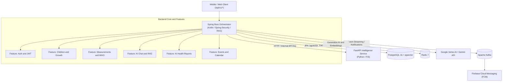

# CuraKid Backend Platform 🚀

[](https://spring.io/projects/spring-boot)
[](https://kotlinlang.org/)
[](https://fastapi.tiangolo.com/)
[](https://github.com/pgvector/pgvector)
[](https://kafka.apache.org/)
[](https://www.docker.com/)

**CuraKid** is an advanced, AI-powered pediatric health monitoring and child development platform. It integrates evidence-based clinical protocols, WHO growth standards, Fuzzy Inference Systems (FIS), Retrieval-Augmented Generation (RAG) powered by Google Gemini, and real-time event streaming to support parents and pediatricians in tracking child growth, developmental milestones, and health assessments.

---

## 🏗 System Architecture

The platform follows a robust **Orchestrator-Worker** microservice architecture:



### Core Components:
1. **Spring Boot Orchestrator (`:springapp` & `:core:*`, `:feature:*`)**: Manages domain logic, authentication, REST API versioned endpoints (`/api/v1`), security filters, RAG pipelines, and database persistence.
2. **Intelligence Service (`intelligence/`)**: A dedicated Python FastAPI microservice running a **Fuzzy Inference System (FIS)** for non-linear health/development risk assessment and the **Laya** neural decision model for fast System 1 clinical triage.
3. **Database (`PostgreSQL + pgvector`)**: Stores relational domain models (children, measurements, assessments, chat sessions) and high-dimensional vector embeddings of medical guidelines for semantic search.
4. **Message Broker (`Apache Kafka`)**: Handles asynchronous event-driven workflows (push notifications, background report generation, token cleanup).
5. **Caching (`Redis`)**: Provides fast caching and session store management.

---

## 📂 Project Structure & Modules

The project is structured as a multi-module Gradle enterprise repository:

- **Root & Infrastructure**:
  - `springapp/`: Main Spring Boot application entry point and configuration.
  - `intelligence/`: Python FastAPI service for Fuzzy Logic & ML embeddings.
  - `infrastructure/`: Docker Compose, init scripts (`schema.sql`), and environment templates.
- **Core Modules (`:core:*`)**:
  - `:core:database`: JPA entities, repositories, and database schemas.
  - `:core:essential`: Common utilities, custom exceptions, pagination (`PagedResponse<T>`).
  - `:core:medical`: Medical domain models and clinical protocol definitions.
  - `:core:security`: Spring Security configuration, JWT filters, and `InternalApiKeyFilter`.
- **Feature Modules (`:feature:*`)**:
  - `:feature:assessments`: Child development tests and milestone evaluation.
  - `:feature:auth`: Authentication, registration, password reset, and Google OAuth.
  - `:feature:chat`: RAG-based AI medical assistant chat (Gemini API, pgvector).
  - `:feature:children`: Child profile management and family linking.
  - `:feature:development`: Developmental milestone tracking.
  - `:feature:event`: Calendar, scheduled medical visits, and event reminders.
  - `:feature:fis`: HTTP client integration with the Python Intelligence service.
  - `:feature:knowledge`: Medical knowledge base and vector embedding indexing.
  - `:feature:measurements`: Physical growth tracking (height, weight, head circumference) against WHO standards.
  - `:feature:notification`: Push notifications (FCM) and Kafka event consumers.
  - `:feature:reports`: Asynchronous AI health report generation engine and PDF/Markdown exporter.

---

## 🛠 Technology Stack

| Layer | Technology |
| :--- | :--- |
| **Backend Framework** | Kotlin 2.3.21, Spring Boot 4.1.2, Spring Security, Spring Data JPA, Spring AI |
| **Decision & Intelligence Service** | Python 3.11+, FastAPI 0.115.5, Fuzzy Inference System (`scikit-fuzzy`), Laya Model |
| **Database & Vector Search** | PostgreSQL 16 with `pgvector` extension |
| **Cache & Broker** | Redis 7, Apache Kafka 3.8.0 (KRaft mode) |
| **Generative AI & RAG** | Google Vertex AI / Gemini API, Spring AI |
| **Push Notifications** | Firebase Cloud Messaging (FCM) |
| **Containerization** | Docker, Docker Compose, Gradle 8+ |

---

## 📋 Prerequisites

Before running the platform, ensure you have installed:
- **Docker** and **Docker Compose** (v2.20+)
- **JDK 21** (for local Gradle builds)
- **Python 3.11+** & `pip` / `uv` (if running Intelligence service locally)
- **Google Cloud SDK** (with an active Google Cloud Project and Gemini API access)

---

## ⚙️ Environment Configuration

1. Copy the environment template:
   ```bash
   cp .env.example .env
   ```
2. Configure the required environment variables in `.env`:
   - `JWT_SECRET`: Secret key for JWT signing (minimum 32 characters / 256 bits).
   - `INTERNAL_API_KEY`: Shared secret key for secure inter-service communication between Spring Boot and FastAPI.
   - `GOOGLE_AI_API_KEY` / `SPRING_AI_GOOGLE_GENAI_API_KEY`: Your Google Gemini / Vertex AI API key.
   - `SPRING_DATASOURCE_URL`, `SPRING_DATASOURCE_USERNAME`, `SPRING_DATASOURCE_PASSWORD`: PostgreSQL connection details.
   - `SPRING_DATA_REDIS_PASSWORD`: Redis password.

---

## 🔑 Google AI & Vertex AI Authentication

To enable generative AI capabilities and RAG chat:
1. Ensure your Google Cloud Project has the **Vertex AI API** enabled.
2. Authenticate locally via Google Cloud SDK:
   ```bash
   gcloud auth application-default login
   ```
3. Place your Firebase service account key at `serviceAccountKey.json` in the root directory for push notifications.

---

## 🚀 Getting Started

### Option 1: Run with Docker Compose (Recommended)
This starts all services (Spring Boot, Python FastAPI, PostgreSQL with `pgvector`, Redis, and Kafka) in a networked environment:

```bash
# Build and start all containers in background
docker compose up --build -d

# View backend logs
docker compose logs -f backend
```

- **Spring Boot API**: `http://localhost:8080`
- **Intelligence Service**: `http://localhost:8000` (First startup may take 2–5 minutes while downloading the base ML model ~1GB).

### Option 2: Local Hybrid Development
If you prefer running services directly on your host machine:

1. Start infrastructure services (Postgres, Redis, Kafka):
   ```bash
   docker compose up -d postgres redis kafka intelligence
   ```
2. Run the Spring Boot application:
   ```bash
   ./gradlew :springapp:bootRun
   ```

---

## 📡 REST API Versioning & Conventions

All REST endpoints are standardized under the **`/api/v1/...`** prefix:
- **Pagination**: Paginated responses use the custom `PagedResponse<T>` wrapper containing content, page number, size, total elements, and total pages.
- **Security**: Protected endpoints require a valid Bearer JWT token in the `Authorization` header. Internal inter-service requests use the `X-Internal-API-Key` header verified by `InternalApiKeyFilter`.
- **Validation**: Path variables and request bodies are validated using JSR-380 annotations (`@NotNull`, `@Min`, `@Size`).

---

## 🧪 Testing & Code Quality

### Spring Boot Tests & JaCoCo Coverage
To run unit and integration tests across all modules and generate a JaCoCo coverage report:
```bash
./gradlew test jacocoTestReport
```
Report location: `springapp/build/reports/jacoco/test/html/index.html`

### Intelligence Service Tests (Python)
```bash
cd intelligence
python -m venv .venv
source .venv/bin/activate
pip install -r requirements.txt
pytest --cov=src test/
```

### Code Formatting & Linting
```bash
./gradlew ktlintCheck
```

---

## 🛠 Troubleshooting

- **Backend connection error to Intelligence Service**: The Spring Boot backend may start before FastAPI is fully ready. Wait for the intelligence service healthcheck to pass, then restart the backend: `docker compose restart backend`.
- **JWT Signature Exception**: Ensure `JWT_SECRET` in `.env` is at least 32 characters long.
- **Postgres `vector` extension missing**: The initialization script (`infrastructure/init.sql`) automatically executes `CREATE EXTENSION IF NOT EXISTS vector;`. Ensure your database user has superuser or extension creation privileges.

---

## 📄 License

This project is developed as a diploma project. All rights reserved.
